# King Boosting

A multi-role order marketplace with server-side pricing, Stripe PaymentIntents, a policy-driven dashboard and real-time chat. Customers buy game boosts, boosters claim and play the orders, and staff run the back office.

**Built 2020–2021 for a client · rebuilt 2026.** Live demo: **https://kingboosting.dsalim.dev**. Sign in with the [demo accounts](#demo-accounts); payments run in Stripe's test mode.

> Portfolio demo · not affiliated with Riot Games · test payments only

## What it does

- **Customers** build an order and see a live price for it. They pay through Stripe's Payment Element (3-D Secure included), then follow the order: chat with their booster, pause or resume it, and get a notification at each step.
- **Boosters** claim paid orders from a jobs board, see the customer's game login only while they play, complete orders, and watch their earnings. Fines come off their payouts.
- **Moderators** support every order without seeing prices or credentials.
- **Admins** see revenue and order metrics. They pay boosters out in batches, issue fines, review booster applications and manage roles.

Every rule is enforced on the server: one policy layer decides what each role can see and do, and the dashboard shows only the actions the API allows. Prices come from rate tables kept in config, in whole cents, so the browser never sets one.

## Screenshots

| | |
| --- | --- |
| 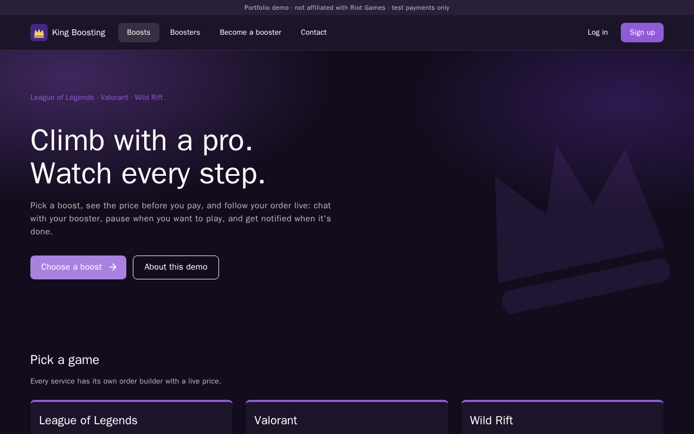 | 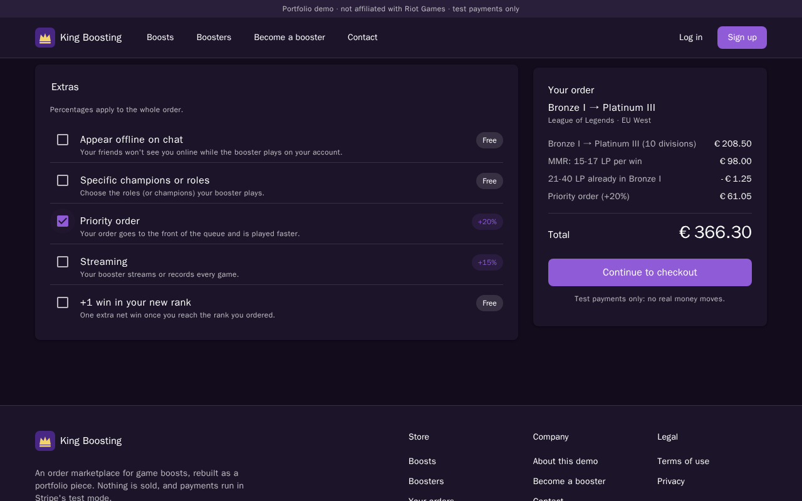 |
| **Storefront** | **Order builder.** The price comes from the server. |
| 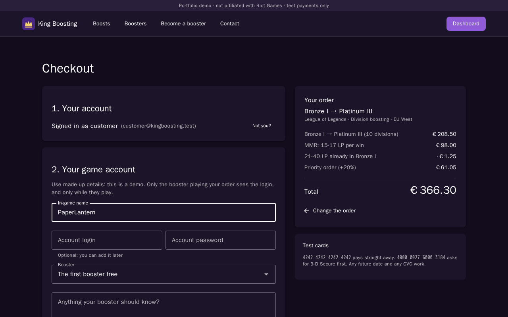 | 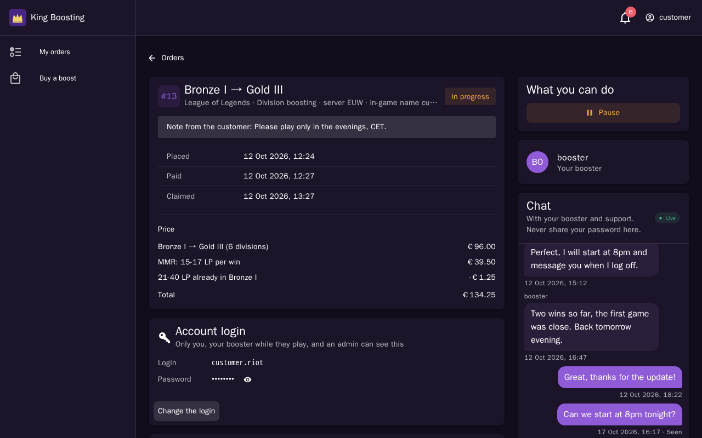 |
| **Checkout**, with sign-in on the page | **A customer's order**: price, login, timeline and chat |
| 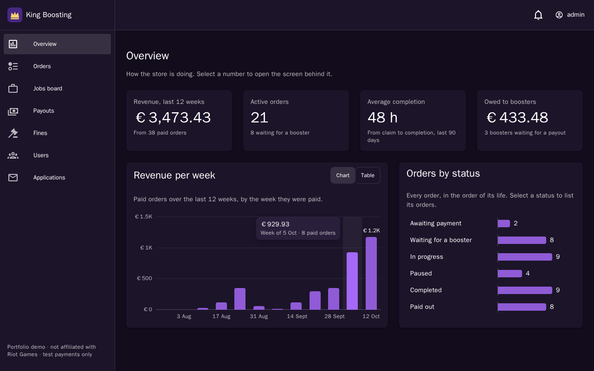 | 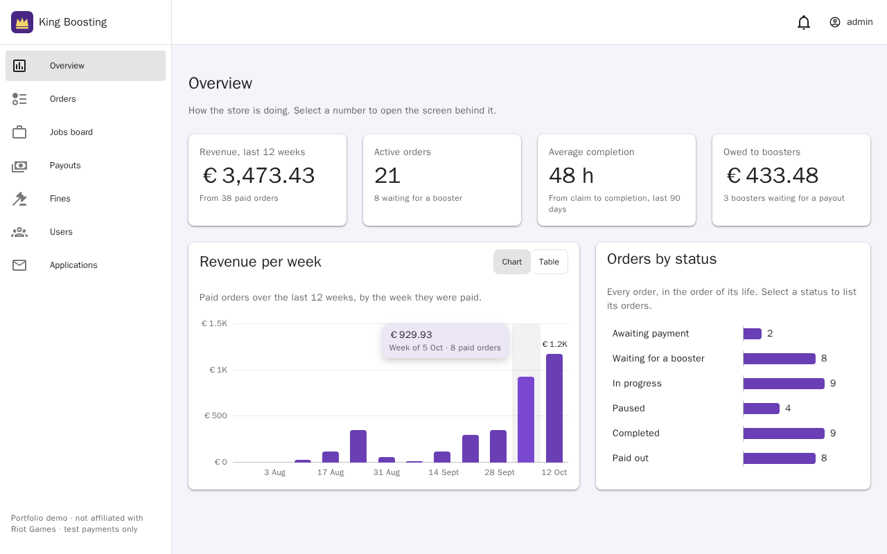 |
| **Admin overview**, dark | **Admin overview**, light |
| 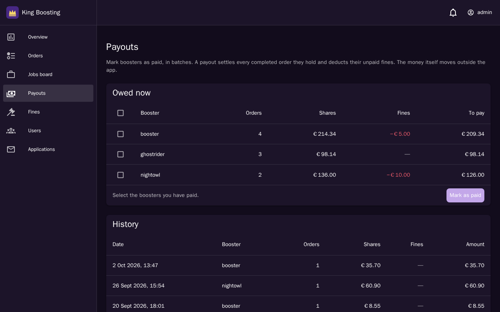 | 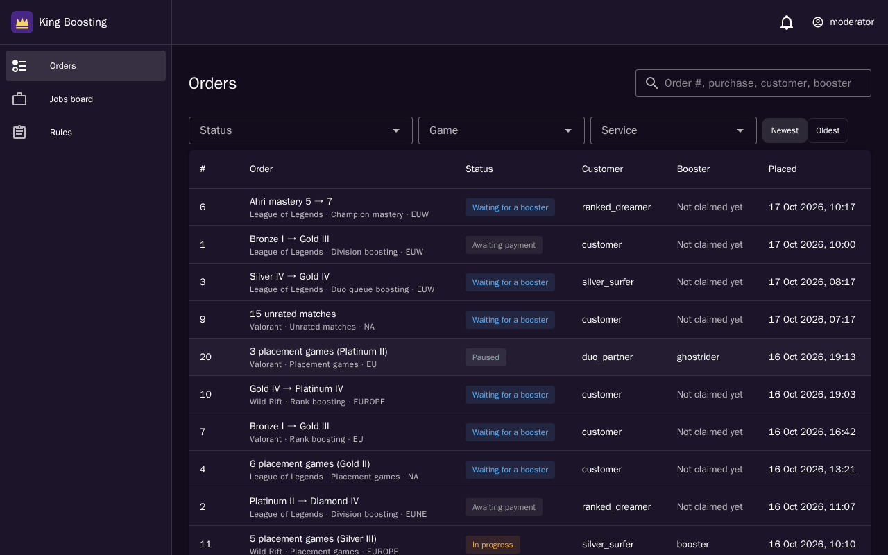 |
| **Payouts in batches** (admin) | **Every order** (moderator) |
| 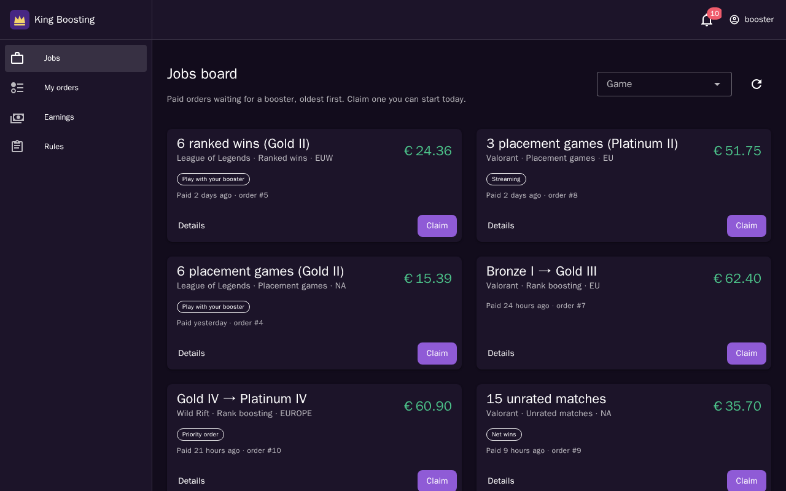 | 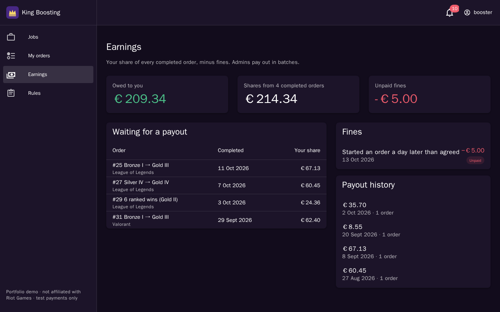 |
| **Jobs board** (booster) | **Earnings and fines** (booster) |

**Real-time chat.** The customer is on the left and the booster on the right, each in their own browser. Messages arrive over Reverb, and the sender sees "Seen" once the other side has read them.

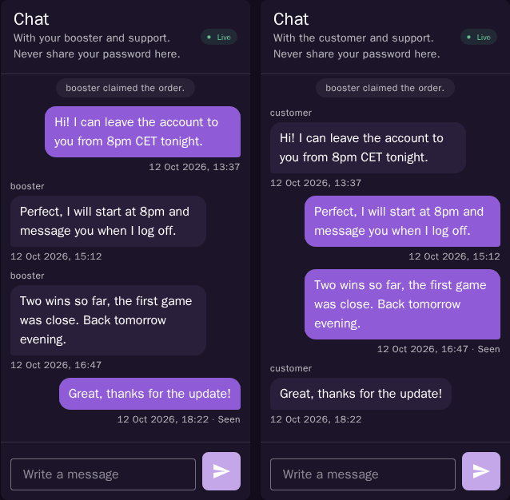

**Two boosters claim the same order at the same moment.** The claim is one conditional update, so exactly one wins. The other gets a 409 and a message instead of a corrupted order.

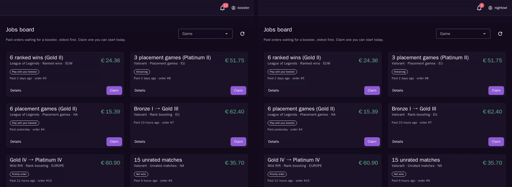

## Architecture

One origin, routed by path ([ADR 0001](docs/adr/0001-single-origin-routing.md)). Sanctum's session cookie therefore works everywhere with no CORS, and Echo reaches Reverb on the same host.

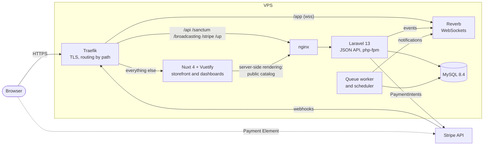

### An order's life

In production, Stripe's signed webhook is the only thing that marks an order paid. Every transition locks the order's row, re-checks the policy against it, and records a timeline event. Each event posts a system message in the order's chat and notifies the people involved, in the app and by email.

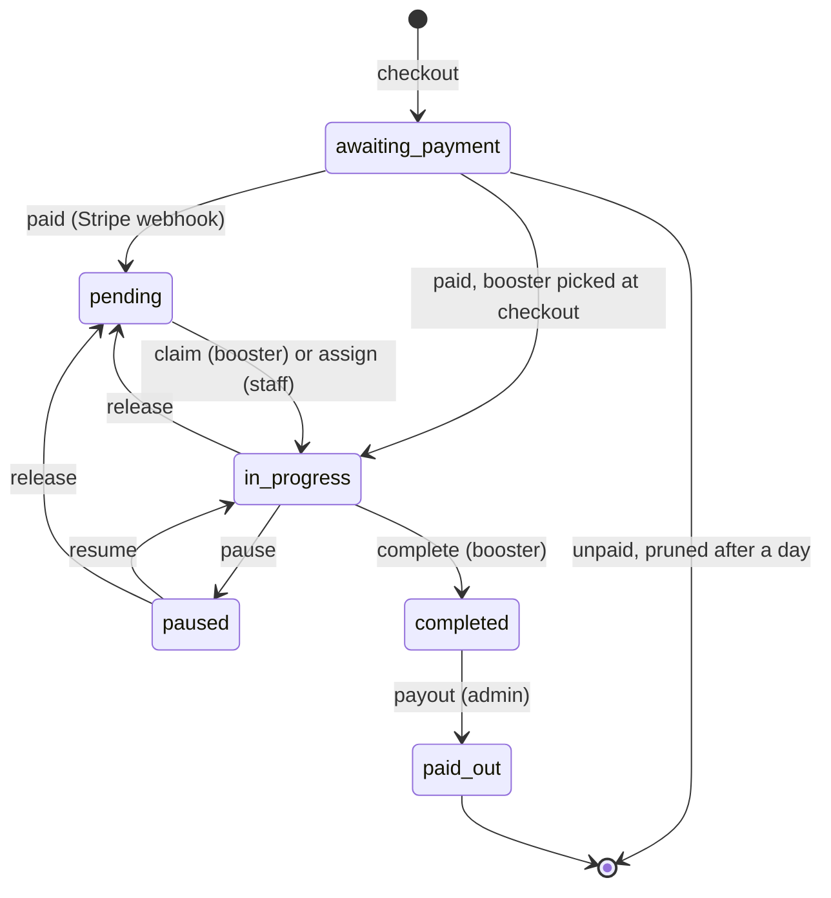

### Who can do what

| | Admin | Moderator | Booster | Customer |
| --- | --- | --- | --- | --- |
| See orders | all | all | the jobs board, and the orders they hold | their own |
| See the game login | ✓ | | while playing it | their own |
| See prices | ✓ | | their share | their own |
| Claim | | | pending orders | |
| Assign | ✓ | ✓ | | |
| Pause, resume | ✓ | ✓ | as the holder | as the owner |
| Release | ✓ | ✓ | as the holder | |
| Complete | | | as the holder | |
| Pay out, fine | ✓ | | | |
| Chat on the order | ✓ | ✓ | as the holder | as the owner |
| Users, roles, applications | ✓ | | | |

[`docs/order-rules.md`](docs/order-rules.md) has the exact table by order status. `tests/Feature/Policies/OrderPolicyTest.php` checks every cell. An action that is allowed in general but not in the order's current status (say, the order was claimed a second ago) gets a 409 with the reason; anything else gets a 403.

### Stack

| | |
| --- | --- |
| API | Laravel 13 on PHP 8.4, Sanctum SPA cookie auth, Reverb, Stripe PHP, Pest, Larastan level 6, Pint |
| Web app | Nuxt 4, Vuetify 4, Pinia, Laravel Echo, Stripe.js, Vitest, Playwright |
| Infrastructure | Docker Compose, MySQL 8.4, Traefik in production, GitHub Actions and GHCR |

## Running it

Docker is all you need: no PHP or Node on your machine, and no licences.

```shell
git clone https://github.com/CaddyDz/KingBoosting.git && cd KingBoosting
docker compose up -d --build --wait
docker compose exec app php artisan migrate --seed
```

The first start installs Composer and npm dependencies inside the containers, so it takes a few minutes. Then:

| URL | What |
| --- | --- |
| http://localhost:8000 | The app. One proxy sends `/api`, `/sanctum`, `/broadcasting`, `/stripe` and `/up` to Laravel, `/app` to Reverb, and the rest to Nuxt. |
| http://localhost:8025 | Mailpit, which catches every email |

On Linux, if your user ID isn't 1000, give the images your IDs before the first build, so files the containers create belong to you: `printf 'HOST_UID=%s\nHOST_GID=%s\n' "$(id -u)" "$(id -g)" >> .env`.

If you ran the legacy stack from this repository before, its database volume has the old schema: run `docker compose down -v` once to start fresh.

### Demo accounts

Every account's password is `password`. `docker compose exec app php artisan demo:reset` brings the data back to the seeded state.

| Email | Role |
| --- | --- |
| `admin@kingboosting.test` | Admin |
| `moderator@kingboosting.test` | Moderator |
| `booster@kingboosting.test`, `nightowl@kingboosting.test` | Boosters |
| `ghostrider@kingboosting.test` | A booster hidden from customers |
| `customer@kingboosting.test`, `ranked_dreamer@`, `silver_surfer@`, `duo_partner@` | Customers |

### Payments

**Without Stripe keys**, the local stack still takes orders: payments run offline, and the payment page offers to simulate Stripe's answer.

**With Stripe**, use test keys only (the app refuses live ones):

1. Put `STRIPE_KEY`, `STRIPE_SECRET` and `STRIPE_WEBHOOK_SECRET` in `backend/.env`.
2. Put `STRIPE_KEY` and `STRIPE_SECRET` in a `.env` next to `compose.yaml`.
3. Run `docker compose --profile stripe up -d stripe`. It forwards Stripe's test webhooks, and `docker compose logs stripe` shows the `whsec_...` secret for step 1.

These test cards work with any future expiry date and any CVC:

| Card | Result |
| --- | --- |
| `4242 4242 4242 4242` | Paid straight away |
| `4000 0027 6000 3184` | Asks for 3-D Secure first |
| `4000 0000 0000 0002` | Declined |

### Tests and checks

```shell
docker compose exec app php artisan test --parallel        # Pest
docker compose exec app ./vendor/bin/pint --test
docker compose exec app ./vendor/bin/phpstan analyse
docker compose exec frontend npm run lint
docker compose exec frontend npm run typecheck
docker compose exec frontend npm test                      # Vitest
docker compose --profile e2e run --rm e2e                  # Playwright; resets the demo data first
```

## Repository

| Path | What |
| --- | --- |
| `backend/` | The Laravel API |
| `frontend/` | The Nuxt app: storefront, checkout and every role's dashboard |
| `docs/adr/` | Decision records: [one origin](docs/adr/0001-single-origin-routing.md), [a role column](docs/adr/0002-role-column.md), [server-side pricing](docs/adr/0003-server-side-pricing.md), [original art](docs/adr/0004-original-art.md), [no Sentry yet](docs/adr/0005-drop-sentry.md), [Pint](docs/adr/0006-pint-house-style.md) |
| `docs/order-rules.md` | The role × action × status rules |
| `docs/pricing-golden.json` | 42 prices recorded from the legacy storefront. The new pricing engine and the order builder both reproduce each one to the cent. |
| `compose.yaml` | The local stack |
| `compose.prod.yaml` | The public demo, behind Traefik. [`docs/deploy.md`](docs/deploy.md) covers the server, Stripe's webhook, deploys and backups. |

## Legacy

The app was first delivered in February 2021 as a Laravel 8 + Nova 3 backend, with a Nuxt 2 storefront added to the repository later. Two tags preserve it:

- [`v1.0-delivered`](https://github.com/CaddyDz/KingBoosting/tree/v1.0-delivered): the delivery merge (backend only).
- [`v1.9-legacy`](https://github.com/CaddyDz/KingBoosting/tree/v1.9-legacy): the last state before the rebuild, with the Nuxt 2 storefront. Running it needs a Laravel Nova licence.

The 2026 rebuild started from an audit of the legacy app. The fixes that mattered most:

- **Access control.**
  - Registration gave new users no role, and the old role checks then treated them as staff: a fresh signup saw every order, with its game login.
  - Any logged-in user could open any order by its ID, because one policy check always returned true.
  - Any user could claim an order or list every user, and customers and boosters could push orders into statuses the rules don't allow.
  - v2 has one policy layer, with every role and status combination tested.
- **Payments.**
  - The price came from the browser, so a customer could set their own.
  - The checkout used Stripe's legacy Charges API, showed USD and charged EUR.
  - An order over €999.99 couldn't be saved after the card was charged.
  - v2 prices orders on the server, takes payment with PaymentIntents and a signed webhook, and stores amounts in integer cents.
- **Chat.**
  - Messages had no authorisation, and one channel per user mixed every order's messages together.
  - v2 has one private channel per order, authorised by the same policy.
- **Payouts.**
  - The amount owed kept only the last order's share and ignored fines, and nothing recorded that a payout happened.
  - v2 records each payout with the orders and fines it settles.
- **Smaller fixes.** CSRF was off app-wide, registration emailed passwords in plain text, and several storefront prices came out as `NaN`.

## Credits

Built by [Salim Djerbouh](https://github.com/CaddyDz), with KitaniIslam, Riyadh Aissi, Abd el hak, Sadoudi Anis, Oussama Bouguerne and benyou1969, who worked on the 2020–2021 version. The legacy Nuxt storefront was imported in one commit (`01d7447`, January 2023), so `git blame` doesn't show their frontend work.

## Disclaimer

King Boosting is a portfolio demo. Nothing is sold and payments run in Stripe's test mode. League of Legends, Valorant and Wild Rift are trademarks of Riot Games, Inc. King Boosting isn't endorsed by Riot Games and isn't affiliated with it.
